# NeriPlayer Desktop · 音理音理（Linux 原生 Qt 版）

把 Android 应用 [NeriPlayer](https://github.com/cwuom/NeriPlayer) 移植为**不依赖 Android / 浏览器内核**的
Linux 原生桌面音乐播放器。

- **前端**：Qt 6 / QML（Qt Quick + 自绘 Material 3 风格组件），原生窗口、动画、托盘与系统集成；
- **后端**：Kotlin 无头服务进程（媒体库、音频引擎、在线音源、下载、GitHub 同步、MPRIS、托盘、全局快捷键），
  与前端通过 **Unix domain socket 上的 JSON 协议**通信（见 [`docs/protocol.md`](./docs/protocol.md)）。
  前端进程不依赖 JVM 图形栈，内存与启动开销比 Compose Desktop 版低得多；
- **主题跟随系统**：深浅色与强调色取自桌面环境（KDE/GNOME），再用 Material Color Utilities 生成整套 M3 色板；
- **打包**：单个 `.deb`，内置 jlink 精简 JRE（用户无需安装 JDK），约 42 MB。

<p align="center">
  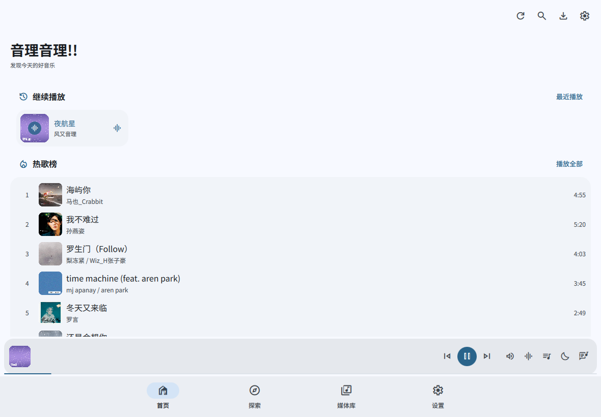
  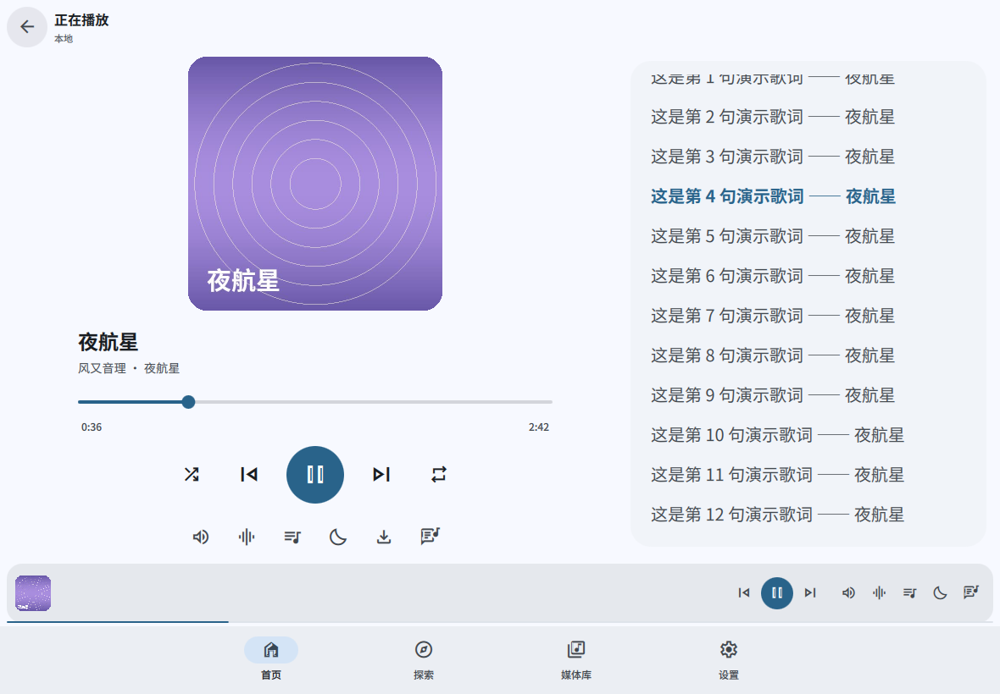
</p>

## 界面预览

| | |
| --- | --- |
| 首页：继续播放 / 为你推荐 / 热歌榜 <br>  | 探索：搜索、热门搜索、风格标签、推荐歌单 <br> 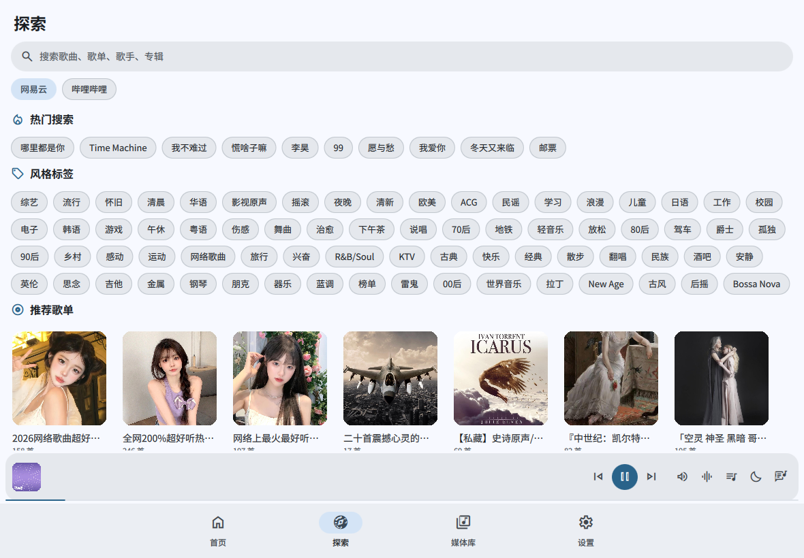 |
| 媒体库：本地 / 收藏 / 在线音源 <br> 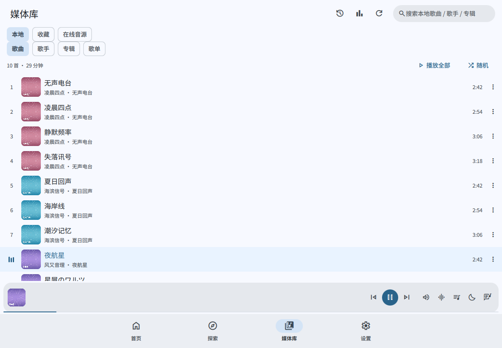 | 播放页：封面、进度、歌词侧栏、工具行 <br>  |
| 播放队列面板 <br> 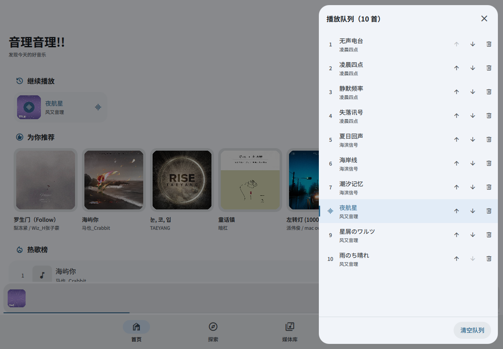 | 音效面板：倍速 / 变调 / 响度 / 十段均衡器 <br> 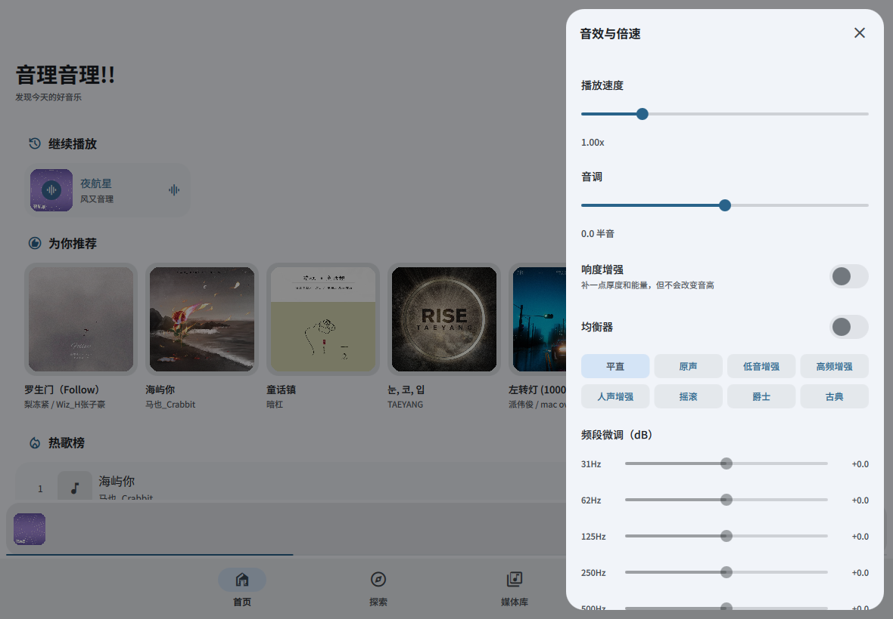 |
| 音量面板 <br> 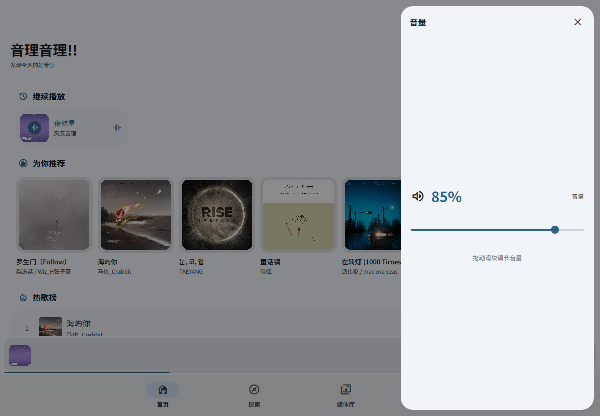 | 睡眠定时器 <br> 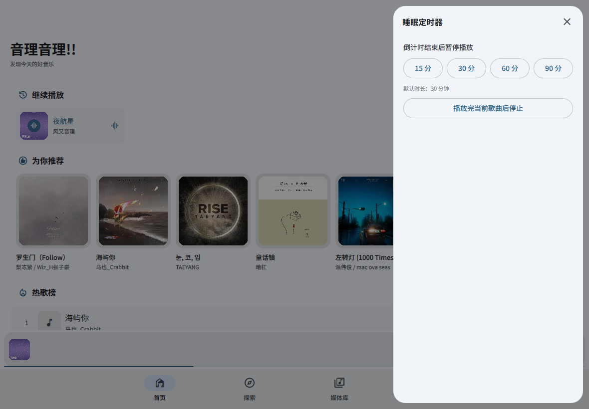 |
| 设置：主题 / 媒体库 / 播放 / 下载 / 悬浮歌词 / 账号 / 同步 / 快捷键 <br> 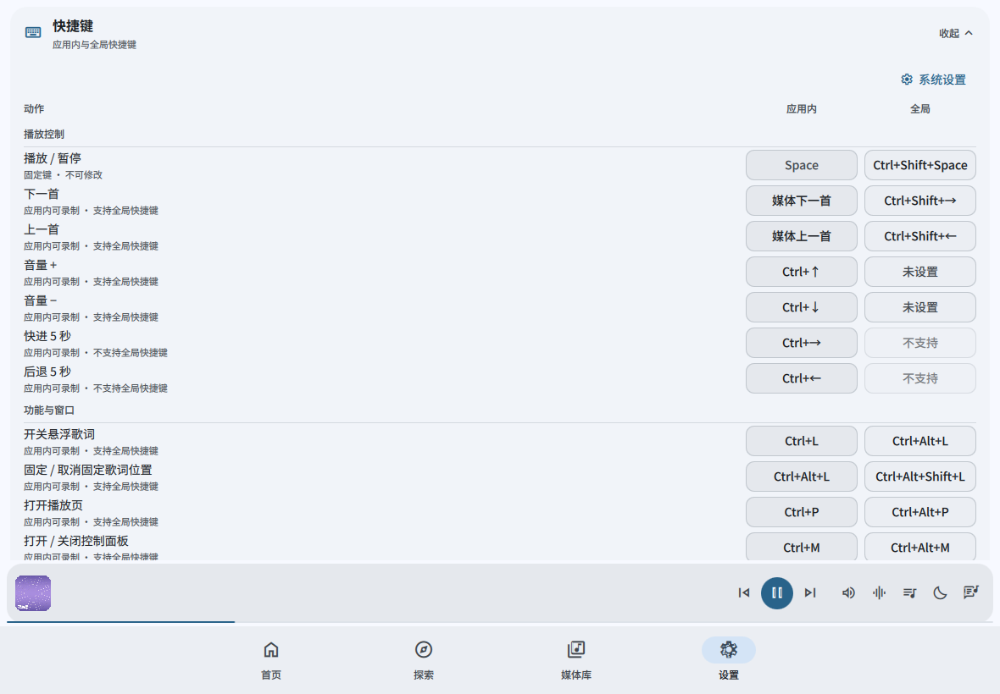 | 窄窗口（单栏）设置页 <br> 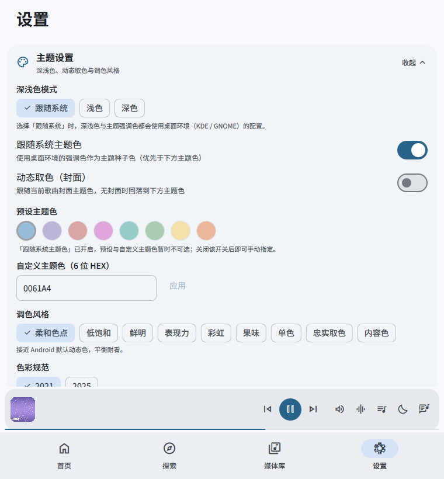 |
| 深色主题（跟随系统强调色） <br> 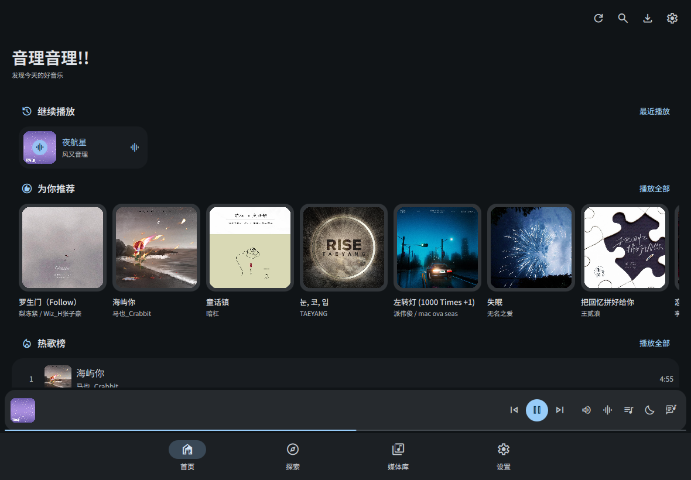 | 深色播放页 <br> 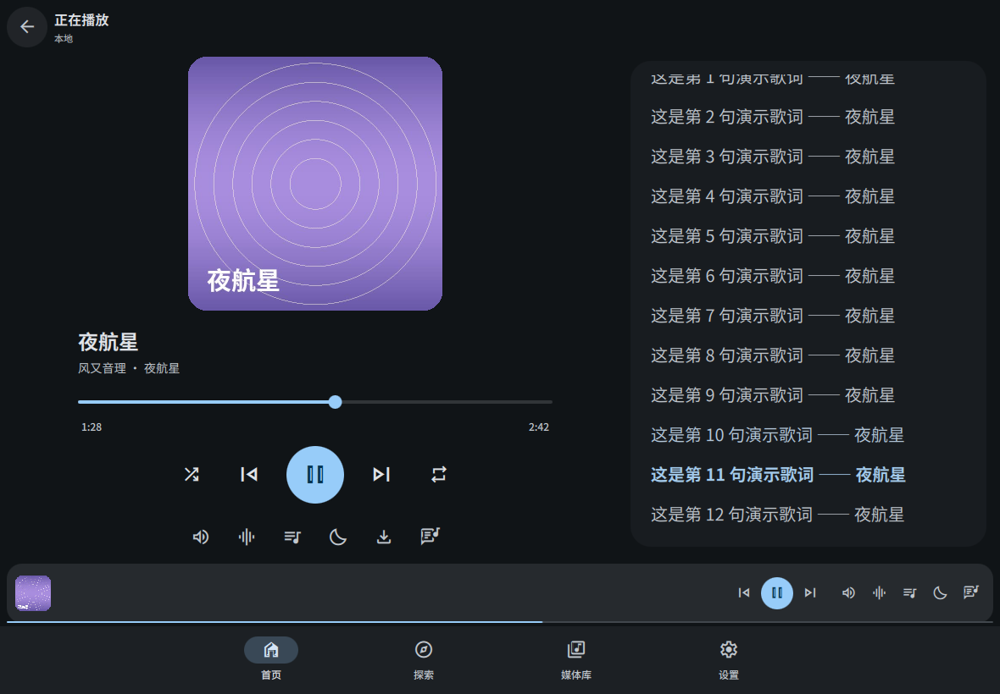 |
| 悬浮歌词（置顶、可拖动、锁定时鼠标穿透） <br> 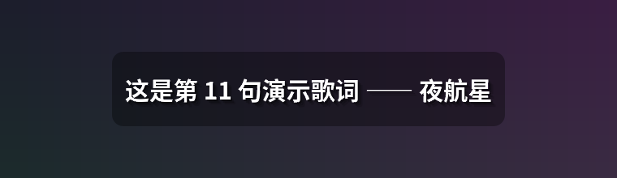 | 托盘控制面板 <br> 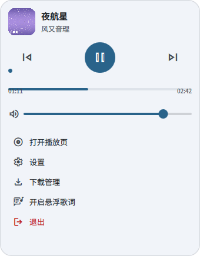 |
| 扫码登录（网易云 / 哔哩哔哩） <br> 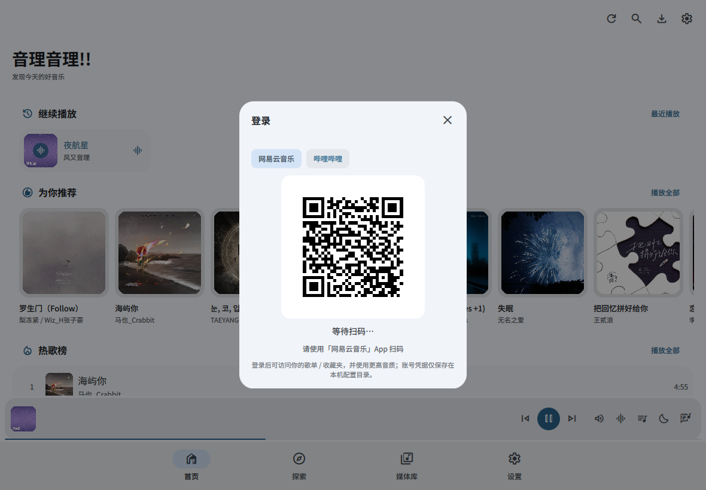 | 下载管理 <br> 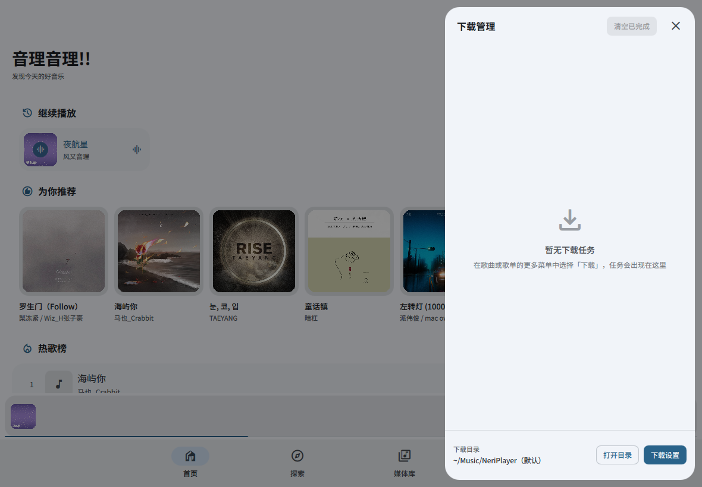 |

## 下载与安装

从 [Releases](https://github.com/Asternent/NeriPlayerForLinux/releases) 下载最新的
`neriplayer_<版本>_amd64.deb`：

```bash
sudo dpkg -i neriplayer_2.0.0_amd64.deb
neriplayer          # 或从应用菜单启动「NeriPlayer」
```

- 安装包内置精简 JRE，终端用户**不需要**安装 JDK。
- 建议安装 `ffmpeg`：用于解码 m4a / aac / opus，并提供倍速、变调、响度增强与十段均衡器；
  缺少时自动降级到 Java Sound 引擎（mp3 / flac / ogg / wav 仍可播放）。
- 主题默认跟随系统：深浅色取桌面设置，强调色取 KDE/GNOME 的系统强调色；也可以在设置里手动指定主题色或开启「动态取色（封面）」。
- 首次启动显示使用须知，随后在「设置 → 媒体库」添加音乐文件夹并扫描即可建立本地曲库。

## 功能

| 功能 | 状态 |
| --- | --- |
| 首页（继续播放 / 为你推荐 / 热歌榜 / 推荐新歌 / 私人雷达 / 热门榜单） | ✅ 网易云公开接口 + 本地历史回退 |
| 探索（搜索、搜索历史、热门搜索、风格标签、推荐歌单、标签歌单） | ✅ 网易云 / 哔哩哔哩 |
| 媒体库（本地歌曲 / 歌手 / 专辑 / 歌单、收藏、搜索与排序） | ✅ 文件夹扫描、读取标签与内嵌封面 |
| 在线歌单 / 专辑 / 歌手详情 | ✅ 网易云 + 哔哩哔哩（B 站无专辑/标签体系） |
| 播放引擎 | ✅ ffmpeg 解码（倍速 / 变调 / 响度 / 十段均衡器）+ Java Sound 回退 |
| 歌词 | ✅ 本地 `.lrc` → 内嵌标签 → 在线歌词；翻译、逐行高亮、点击跳转、字号调节、全屏歌词 |
| 悬浮歌词 | ✅ 无边框置顶窗口，可拖动定位、锁定鼠标穿透、描边/阴影样式与颜色可调 |
| 播放队列 / 音量 / 睡眠定时器 / 音效面板 | ✅ 播放页与迷你播放条均可打开 |
| 账号登录 | ✅ 网易云与哔哩哔哩应用内扫码登录（后端直接生成二维码） |
| GitHub 同步 | ✅ 歌单 / 收藏 / 最近播放 / 播放统计，与手机端数据互通 |
| 歌单与收藏 | ✅ 自建歌单、我喜欢的音乐、增删与排序、收藏到歌单 |
| 最近播放 / 播放统计 | ✅ 日 / 周 / 月 / 年 / 总，按次数、时长、最近排序 |
| 下载 | ✅ 单曲 / 批量下载、进度与取消重试、离线播放、下载面板与管理 |
| 主题 | ✅ 跟随系统（深浅色 + 强调色）、动态取色（封面）、9 种调色风格、2021/2025 色彩规范 |
| 系统集成 | ✅ 托盘（StatusNotifierItem + DBusMenu）、托盘控制面板、MPRIS 媒体键、全局快捷键（xdg portal）、单实例、关闭到托盘 |
| 界面缩放 | ✅ 跟随系统 HiDPI；设置里可选 100%–250% 手动档（下次启动生效） |
| 与手机端同步协议互通 | ✅ 同一仓库、同一文件格式（JSON 与省流二进制） |

尚未迁移的增强项（后续版本）：媒体库「在线音源」子页（在线歌单 / 收藏夹浏览已可从探索与详情页完成）、
歌单拖拽排序、快捷键录制交互、设置页宽屏双列布局。旧 Compose Desktop 前端已移除，历史版本见 git 记录。

### 与原 Android 应用的差异

状态栏歌词、桌面小组件、启动器快捷方式、USB DAC 独占、省电保活与 ANR 日志、一起听（依赖自建服务端）
等 Android 平台专有能力不适用；YouTube Music 需要 Google 账号授权与专用解析，桌面端保留配置入口与说明。

## 快捷键

应用内（窗口有焦点时）：

| 按键 | 作用 |
| --- | --- |
| `空格` | 播放 / 暂停 |
| `Ctrl+←` / `Ctrl+→` | 后退 / 前进 5 秒 |
| `Ctrl+↑` / `Ctrl+↓` | 音量 + / − |
| `Esc` | 关闭浮层 / 返回上一页 |
| `Ctrl+H` / `Ctrl+N` / `Ctrl+J` / `Ctrl+S` | 首页 / 探索 / 媒体库 / 设置 |
| `Ctrl+P` | 打开播放页 |
| `Ctrl+D` | 打开下载管理 |
| `Ctrl+M` | 打开托盘控制面板 |
| `Ctrl+L` / `Ctrl+Alt+L` | 开关悬浮歌词 / 固定歌词位置 |
| `媒体键` | 播放 / 暂停、上一首、下一首（MPRIS，应用在后台也生效） |

全局快捷键通过 xdg-desktop-portal 注册（KDE 首次启动会弹出授权/配置窗口），默认建议值：
`Ctrl+Shift+空格` 播放暂停、`Ctrl+Shift+←/→` 上下首、`Ctrl+Alt+L` 悬浮歌词、`Ctrl+Alt+P` 播放页、
`Ctrl+Alt+M` 控制面板；可在「设置 → 快捷键」打开系统配置界面修改。

## 架构

```
neriplayer（Qt 进程）
  ├─ QML 界面：qml/Main.qml、AppShell、pages/、components/
  ├─ BackendClient：Unix socket 行分隔 JSON 客户端（自动拉起后端、断线重连）
  └─ 系统主题：读取 Qt 调色板 / 系统强调色，上报给后端算色板
        │  $XDG_RUNTIME_DIR/neriplayer/core.sock
        ▼
neriplayer-core（Kotlin/JVM 无头后端，内置 jlink JRE 启动）
  ├─ 播放引擎（ffmpeg + Java Sound）、媒体库、在线音源、下载、GitHub 同步
  ├─ 托盘（StatusNotifierItem）/ MPRIS / 全局快捷键（xdg portal）
  └─ JSON-RPC 服务：backend/CoreServer + backend/api/*Api.kt
```

- 数据目录与旧版共用：`~/.local/share/NeriPlayer`、`~/.config/NeriPlayer`、`~/.cache/NeriPlayer`。
- 协议： [`docs/protocol.md`](./docs/protocol.md) + `docs/protocol-*.md`；
- 开发指南：[`qt/docs/qt-dev-guide.md`](./qt/docs/qt-dev-guide.md)。

## 从源码构建

依赖：JDK 17、Qt 6.5+ 开发包（qt6-base-dev / qt6-declarative-dev / qt6-svg-dev / qt6-wayland-dev）、
cmake、ninja。Debian/Ubuntu 可直接 `sudo apt install openjdk-17-jdk qt6-base-dev qt6-declarative-dev qt6-svg-dev qt6-wayland-dev cmake ninja-build`。

```bash
# 1) 构建后端 jar
cd desktop
JAVA_HOME=/usr/lib/jvm/java-17-openjdk-amd64 ./gradlew backendJar --offline   # 产物 build/libs/neriplayer-core.jar

# 2) 构建并开发运行 Qt 前端（测试数据隔离在 /tmp/neri-dev，不碰真实曲库）
cd qt
tools/dev.sh backend                        # 启动测试后端
tools/dev.sh app                            # 在桌面上启动应用
tools/dev.sh screenshot /tmp/shot.png --page home   # 离屏截图（CI/无头环境用）

# 3) 打 deb 安装包（Qt 前端 + jlink 精简 JRE + 后端 jar）
packaging/build-deb.sh 2.0.0
```

## 与上游同步

桌面版代码全部位于 `desktop/`，与上游 Android 工程零重叠，合并上游更新时通常只需处理 README。
详见 [`docs/upstream-sync.md`](./docs/upstream-sync.md)。

## 许可证

GPL-3.0-only，与原项目一致。图标字体（Material Symbols）遵循 Apache 2.0。
